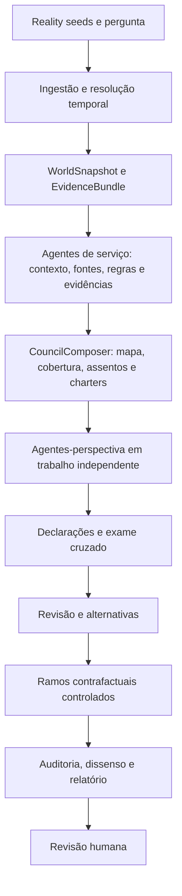

# Especificação do swarm de agentes do Shadow Council

**Status:** proposta de desenho, versão 0.1  
**Data:** 12 de novembro de 2026  
**Idioma:** explicação em português brasileiro; identificadores canônicos em inglês  
**Escopo:** composição, funções e interação dos agentes do Shadow Council Simulation Environment (SCSE)

## 1. Intenção

Definir como compor e coordenar um swarm que examine políticas regulatórias e soluções de IA por perspectivas de stakeholders documentadas. O swarm deve ampliar a variedade de argumentos, explicitar lacunas e preservar dissensos com rastreabilidade suficiente para revisão humana.

O desenho adapta ao SCSE o fluxo conceitual associado ao MiroFish — construção do mundo, configuração de perspectivas, simulação, relatório e interação posterior. Ele não depende de copiar o MiroFish nem de usar o OASIS como motor obrigatório. O mundo da execução é um `WorldSnapshot` versionado; cada agente do conselho é uma `PerspectiveAgent` com `PerspectiveCharter`; a interação é deliberativa, limitada por etapas e registrada como eventos.

O resultado é um conselho sintético que representa recortes de perspectivas documentadas. Não é uma amostra de pessoas, uma consulta pública, uma votação democrática nem uma fonte de autoridade jurídica.

## 2. Objetivos

- Definir perfis de agente rastreáveis aos stakeholders já descritos nos documentos HRAI-GO e SCSE.
- Separar agentes de perspectiva dos agentes de serviço que verificam fontes, contexto, regras, evidências e proveniência.
- Estabelecer entradas, permissões, memórias, ações, protocolo de interação e saídas para cada execução.
- Suportar `regulatoryPolicy` e `solutionCompliance` sem misturar deliberação de política com determinação de conformidade.
- Tornar visíveis fontes, incertezas, conflitos, posições não representadas, revisões e opiniões minoritárias.

## 3. Não objetivos e limites

- Não inferir a distribuição real de opiniões, preferências ou votos de uma população a partir de agentes sintéticos.
- Não gerar personas biográficas, identidades, mandatos ou experiências pessoais fictícias para dar aparência de autenticidade a uma perspectiva.
- Não certificar conformidade, emitir parecer jurídico, substituir consulta pública ou tomar decisões administrativas ou legislativas.
- Não permitir que os agentes do conselho alterem o `LegalSnapshot`, as evidências de origem ou achados formais do `LegalAssessmentEngine`.
- Não inferir causalidade ou prever efeitos sociais reais sem desenho empírico validado.
- Não especificar implantação, fornecedor de modelo, banco de dados ou interface de usuário.

## 4. Base documental e decisões de desenho

Esta especificação deriva principalmente de:

- `docs/scse/SCSE_Shadow_Council_Simulation_Spec.tex`, em especial as seções de composição, memórias, protocolo deliberativo, motor jurídico, governança, avaliação e MVP.
- `docs/hrai-go/HRAI-GO_Plataforma_Inteligencia_Regulatoria_Shadow_Council.tex`, em especial as seções Shadow Council, estratificação, agentes especializados e governança de contribuições.
- `ontologies/scse/SCSE_Shadow_Council_Ontology.ttl` e `schemas/scse/`, como referências de entidades, ações e contratos já propostos.

As decisões abaixo completam pontos que os documentos deixam abertos ao desenho do swarm:

1. **Duas famílias de agentes:** agentes-perspectiva ocupam assentos do conselho; agentes de serviço entregam análises auxiliares. Só os primeiros expressam posições de stakeholders.
2. **Catálogo padrão de oito estratos:** usar os oito estratos documentados como ponto inicial para cobertura. A composição concreta é específica da pergunta, jurisdição, período e corpus.
3. **Vinte assentos como configuração exploratória de referência:** manter a distribuição ilustrativa documentada para facilitar comparação inicial. As quotas não são obrigatórias, não atribuem peso político e não devem ser interpretadas como proporção populacional.
4. **Um agente por assento:** cada `CouncilSeat` recebe uma instância isolada. Assentos no mesmo estrato só recebem perfis distintos quando houver fontes que justifiquem a diferença.
5. **Seis rodadas deliberativas:** manter R1–R6 como as rodadas contadas, com R0 de preparação e R7–R8 de auditoria e publicação, conforme o SCSE.
6. **Saída em eventos tipados:** toda interação relevante produz eventos estruturados e argumentos citáveis; conversas livres não são o registro canônico.

## 5. Modelo mental do swarm



O fluxo adapta a sequência conceitual do MiroFish sem importar suas premissas de simulação social. A fonte de verdade do caso é o estado congelado do SCSE. Os agentes de perspectiva só recebem material daquele estado e das ferramentas explicitamente autorizadas para sua tarefa.

### 5.1 Fronteira de autoridade

| Camada | Agentes | Podem fazer | Não podem fazer |
|---|---|---|---|
| Preparação do cenário | `SeedIngestionService`, `LegalSnapshotResolver`, `WorldModelBuilder` | Extrair, versionar e relacionar fontes, fatos e contexto | Transformar hipótese em norma vigente |
| Serviços especialistas | Agentes de serviço descritos na seção 7 | Produzir resultados auxiliares rastreáveis e sinalizar incerteza | Falar em nome de um stakeholder ou alterar evidência de origem |
| Conselho | Agentes-perspectiva da seção 6 | Sustentar, questionar, revisar e contextualizar argumentos | Determinar conformidade, representar pessoas reais ou decidir política |
| Controle e garantia | `ShadowCouncilOrchestrator`, `EvidenceReviewAgent`, `DeliberationAuditAgent`, `ProvenanceAuditAgent` | Controlar etapas, verificar requisitos de qualidade e compilar trilha | Apagar dissenso ou escolher uma posição política vencedora |
| Decisão | Revisores e autoridades humanas competentes | Interpretar os resultados e decidir segundo seu mandato | Tratar a simulação como consulta ou evidência empírica por si só |

## 6. Agentes-perspectiva e mapa de stakeholders

Cada linha abaixo é um perfil de cobertura, não uma persona fixa. O `CouncilComposer` seleciona posições documentadas apropriadas para a pergunta. Se as fontes não permitirem caracterizar um perfil, o assento deve ser omitido ou marcado `unrepresented`; o agente não preenche a lacuna inventando uma posição.

| `StakeholderStratum` / perfil-base | Assentos de referência | Recortes possíveis quando houver base documental | Contribuição típica |
|---|---:|---|---|
| `RegulatorsAndEnforcement` | 3 | Competências distintas; fiscalização, independência, recursos e responsabilização | Exequibilidade institucional, poderes, inspeção, lacunas de competência e riscos de captura |
| `PublicSectorOperators` | 2 | Órgãos operadores, compradores ou prestadores públicos com responsabilidades diferentes | Contratação, prestação de serviço, infraestrutura, capacidade operacional e responsabilidade administrativa |
| `ProductiveSector` | 3 | MPME/startup; empresa de maior escala ou provedora; integrador/desenvolvedor | Custos, concorrência, integração, acesso a mercado, incentivos e capacidade de implementação |
| `ResearchAndExpertise` | 3 | Direito/política pública; computação/segurança; economia/ciências sociais/ética | Qualidade metodológica, pressupostos, evidência disponível, alternativas e consequências possíveis |
| `CivilSocietyAndRights` | 3 | Privacidade/consumidor; direitos digitais; acessibilidade e deficiência | Direitos, mecanismos de contestação, riscos distributivos, transparência e salvaguardas |
| `WorkersAndProfessions` | 2 | Relações de trabalho; autonomia e supervisão profissional | Efeitos sobre emprego, organização do trabalho, supervisão humana e condições de contestação |
| `DirectlyAffectedGroups` | 2 | Usuários/beneficiários do serviço relevante; grupos como candidatos, pacientes ou comunidades quando cabível | Exposição concreta à decisão, barreiras de acesso, dano, recurso e contestação |
| `InfrastructureAndEcosystem` | 2 | Computação/energia/dados/cadeia de suprimentos; sustentabilidade e externalidades | Dependências técnicas, energia, soberania de dados, concentração, cadeia de fornecimento e impacto ambiental |

Os totais reproduzem o exemplo de 20 assentos dos documentos SCSE/HRAI-GO. São quotas exploratórias para cobertura documental, não pesos, votos, direitos de fala proporcionais ou estimativas de tamanho dos grupos. Podem variar por cenário; a alteração deve ficar registrada com justificativa.

### 6.1 Regras de instanciação dos assentos

1. Definir `CouncilQuestion`, modo, jurisdição, `asOfDate`, grupos afetados, escopo do artefato e decisões que estão fora do escopo.
2. Construir `StakeholderMap` com afetados, operadores, reguladores, titulares de direitos, financiadores e peritos pertinentes.
3. Criar `SamplingFrame` documental com critérios de inclusão, idioma, período, tipo de fonte, direitos de uso e limitações conhecidas.
4. Criar uma matriz entre estratos, dimensões de cobertura e posições encontradas. As dimensões mínimas são papel institucional, exposição ao impacto, geografia pertinente e diversidade de teses; porte, setor e acessibilidade são incluídos quando sustentados.
5. Distinguir posições opostas dentro do mesmo estrato quando fontes indicarem divergência. Não forçar simetria quando uma das posições não tiver documentação.
6. Alocar assentos a posições verificáveis. Cada posição substantiva precisa de pelo menos uma fonte rastreável; alegações importantes devem apontar trechos específicos.
7. Marcar o que não foi coberto como `unrepresented`, explicando se a lacuna decorre de falta de fonte, escopo, idioma, período ou critério de seleção.
8. Registrar critérios, quota, fontes, limites, conflitos de interesse e versão do perfil no `CouncilRoster` e no `RunManifest`.

## 7. Agentes de serviço e garantia

Estes agentes apoiam o conselho e a plataforma; não são assentos de stakeholders nem participantes com preferências próprias. Os agentes já propostos no documento HRAI-GO são mantidos, com atribuições alinhadas ao fluxo SCSE.

| Agente canônico | Fase | Função e saída | Limite de autoridade |
|---|---|---|---|
| `ShadowCouncilOrchestrator` | Controle | Instanciar o plano, rotear tarefas, controlar rodadas, limites, reexecuções e condições de parada | Não redige posição final nem desempata disputa substantiva |
| `LegalSourceMonitorAgent` | Preparação | Consultar e registrar alterações de fontes normativas oficiais e metadados temporais | Não declara sozinho o estado jurídico; remete ao `LegalSnapshotResolver` e à revisão configurada |
| `NormativeExtractionAgent` | Preparação | Extrair requisitos candidatos, condições, exceções e trechos de origem | Uma extração é candidata até validação; não produz parecer jurídico |
| `OntologyAlignmentAgent` | Preparação | Mapear conceitos extraídos para classes e propriedades canônicas | Não altera a ontologia ou valida conteúdo jurídico por conta própria |
| `NationalContextAgent` | Preparação | Montar indicadores e séries com fonte, período, unidade e limitações | Não transforma correlação em causalidade nem completa dados ausentes |
| `ComparativeRegulationAgent` | Preparação/apoio | Encontrar funções regulatórias comparáveis entre jurisdições e apontar diferenças | Não presume equivalência jurídica entre regimes |
| `ComplianceAssessmentAgent` | Mode B | Preparar matriz requisito–evidência e achados conforme regras e estados controlados | Só o motor jurídico e seus validadores atribuem estados formais; nunca usa contagem de argumentos |
| `RegulatoryTensionAgent` | Preparação/Mode A | Propor tensões, hipóteses e perguntas para investigação, com fontes conflitantes quando existirem | Uma tensão é candidata; não é conclusão de dano nem prova de lacuna regulatória |
| `PolicySimulationAgent` | R6/ramificações | Avaliar alternativas condicionais sob hipóteses e parâmetros explícitos | Não prever efeitos reais sem calibração empírica nem escolher a alternativa vencedora |
| `EvidenceReviewAgent` | R3/R7 | Verificar suporte, escopo, data e contradições de claims; produzir pedido de revisão ou estado de verificação | Não converte falta de evidência em prova de violação ou falsidade |
| `DeliberationAuditAgent` | R7 | Medir cobertura, participação dos estratos, rastreabilidade, retenção de dissenso e concentração | Não resolve divergências substantivas nem elimina argumentos minoritários |
| `ProvenanceAuditAgent` | R7/R8 | Verificar linhagem de fontes, versões, prompts, modelos, regras, eventos e resultados | Não valida a verdade material de uma fonte apenas por ter linhagem completa |
| `ReportCompiler` | R8 | Emitir artefatos do relatório, manifesto, grafo de argumentos e anexos de auditoria | Não sintetiza divergência como consenso nem altera eventos registrados |

O `ExternalAgentGateway`, quando habilitado, aplica o mesmo manifesto de capacidades e permissões a agentes de terceiros. Integração externa não concede acesso irrestrito a documentos, memória ou escrita em sistemas de produção.

### 7.1 Dados de serviço entregues ao conselho

O conselho recebe um `EvidenceBrief` comum contendo pergunta, escopo, fatos e documentos selecionados, estado temporal da regulação, resultados verificáveis disponíveis, lacunas, hipóteses e advertências. O brief deve distinguir:

- texto normativo e status jurídico;
- interpretação ou classificação ainda sujeita a revisão;
- evidência empírica observada;
- posição documentada de stakeholder;
- hipótese de agente;
- proposta ou alternativa normativa.

O brief é versionado e igual para todos os agentes durante a revisão inicial. O modo de compliance inclui os achados formais do `LegalAssessmentEngine`, preservando seus estados e referências. Os agentes-perspectiva podem contestar premissas, pedir evidência e discutir implicações, mas não sobrescrever esses achados.

## 8. Contrato de um `PerspectiveAgent`

Cada agente é instanciado com um `PerspectiveCharter` explícito. O charter descreve uma perspectiva documentada e limita seu comportamento; não descreve uma personalidade humana.

| Campo canônico | Descrição e regra de validação |
|---|---|
| `agentId` | Identificador imutável da instância na execução. Não contém nome de pessoa real. |
| `seatId` | Identifica o assento sintético ao qual a instância foi alocada. |
| `stakeholderStratumId` | Referência a um estrato do `StakeholderMap`. |
| `perspectiveLabel` | Rótulo descritivo do recorte documentado, sem atribuir identidade individual ou mandato institucional. |
| `synthetic` | Sempre `true` para agente-perspectiva do conselho. |
| `scenarioScope` | Modo, jurisdição, período, setor e pergunta aos quais o charter se aplica. |
| `documentedPositions` | Posições observadas nas fontes, cada qual ligada a `sourceIds`, trecho, data e estado de verificação. |
| `interests` | Interesses explicitamente documentados ou inferidos como hipótese identificada; inferência exige justificativa e grau de incerteza. |
| `constraints` | Condições de capacidade, competência, recursos, direito ou contexto documentadas. |
| `blindSpots` | Limites conhecidos da cobertura e temas que o agente não deve preencher sem fonte. |
| `allowedActions` | Subconjunto de ações disponível segundo modo e etapa. Deve ser validado antes da execução. |
| `disclosure` | Texto canônico informando que é perspectiva sintética, seu escopo e limitações. |
| `sourceIds` | Inventário de evidências acessível ao agente, com proveniência e versão. |
| `modelVersion` | Identificador de provedor, modelo e versão configurada para a execução, sujeito a disponibilidade de registro. |
| `conflictOfInterest` | Vínculos de financiamento, autoria, seleção de fonte ou interesses institucionais conhecidos; `unknown` é um estado válido. |
| `memoryPolicy` | Indica memória permitida, retenção, isolamento e política de descarte. |
| `insufficientGrounding` | Sinal obrigatório quando uma afirmação substantiva extrapola a documentação disponível. |

### 8.1 Ações permitidas

Usar o vocabulário do SCSE: `assertClaim`, `support`, `challenge`, `requestEvidence`, `revise`, `withdraw`, `proposeAmendment`, `declareUncertainty`, `submitMinorityOpinion` e `abstain`. Cada ação gera `DeliberationEvent` com ator, etapa, timestamp, referências e hash de conteúdo. Uma ação não autorizada é rejeitada e registrada como evento de controle.

Cada `ArgumentClaim` deve conter, no mínimo:

- `claimId`, `agentId`, `roundId` e `claimType`;
- proposição concisa e modalidade (`observed`, `documentedPosition`, `interpretation`, `hypothesis` ou `proposal`);
- `evidenceIds` e recortes citados, ou justificativa explícita de que a afirmação é uma hipótese;
- estado (`supported`, `contested`, `conditional`, `withdrawn` ou `unverified`);
- alvo de contestação, quando houver;
- incerteza, pressupostos, condições e revisão posterior.

### 8.2 Exemplo de charter

Exemplo apenas ilustrativo. A execução deve substituir os identificadores de demonstração por fontes selecionadas e verificadas.

```yaml
agentId: synthetic-sme-01
seatId: seat-product-sector-sme-01
stakeholderStratumId: ProductiveSector
perspectiveLabel: small-enterprise-compliance-capacity
synthetic: true
scenarioScope:
  mode: regulatoryPolicy
  jurisdiction: BR
  asOfDate: 2026-11-12
documentedPositions:
  - positionId: position-cost-and-capacity-01
    summary: "Documented materials describe compliance capacity as a concern for smaller firms."
    sourceIds: [source-example-01]
interests:
  - value: implementation-cost-visibility
    basis: documented
constraints:
  - value: limited-compliance-capacity
    basis: documented
blindSpots:
  - "Cannot state how Brazilian small businesses generally feel without representative evidence."
allowedActions: [assertClaim, support, challenge, requestEvidence, revise, declareUncertainty, submitMinorityOpinion, abstain]
disclosure: "Synthetic perspective based on the listed sources; not a business or an association representative."
sourceIds: [source-example-01]
modelVersion: recorded-in-run-manifest
conflictOfInterest: unknown
memoryPolicy:
  referenceMemory: read-only
  workingMemory: discard-after-run
  episodicMemory: run-scoped
  claimMemory: run-scoped
insufficientGrounding: false
```

## 9. Memória, contexto e isolamento

Cada agente terá as quatro memórias propostas no SCSE:

- `ReferenceMemory`: charter, fontes, evidências e snapshot de referência; leitura somente durante a execução.
- `WorkingMemory`: hipóteses e objetivos da rodada; descartada ao fim da execução.
- `EpisodicMemory`: eventos, objeções e revisões daquela execução; isolada por `SimulationRun`.
- `ClaimMemory`: estado do grafo de argumentos, incluindo claims aceitos, contestados, condicionais e retirados.

Não compartilhar memórias privadas entre sessões. Uma informação só poderá se tornar referência reutilizável depois de revisão de fonte e aprovação. Falas geradas não são dados observados de usuários. Não reter informações pessoais sensíveis sem base, finalidade e controle de acesso explícitos; o conselho deve preferir evidência agregada ou autorizada.

## 10. Protocolo de execução e interação

| Etapa | Agentes e operação | Condição de saída |
|---|---|---|
| R0 `Prepare` | Orquestrador congela pergunta, `WorldSnapshot`, `EvidenceBrief`, corpus, política de memória, limites e roster. Resolver fontes e conflitos. | Snapshot versionado; fontes necessárias verificadas ou limitações explicitadas. |
| R1 `IndependentReview` | Cada assento prepara posição sem acessar saídas de outros agentes. Todos recebem o mesmo brief e suas fontes autorizadas. | Cada agente submete claims preliminares, incertezas ou `abstain`. |
| R2 `OpeningStatements` | Publicar posições independentes com declarações e citações. | Todas as posições publicadas ou falha/abstenção registrada. |
| R3 `CrossExamination` | Roteamento de `challenge` e `requestEvidence` por claim e questão. `EvidenceReviewAgent` auxilia a verificar as referências. | Limite de turnos atingido ou ausência de novos pedidos/argumentos. |
| R4 `EvidenceRevision` | Agentes mantêm, corrigem, condicionam ou retiram claims e registram motivo. | Estado e histórico de cada claim atualizados sem apagar versões anteriores. |
| R5 `Negotiation` | Propor alternativas, salvaguardas, exceções e condições. Registrar conflitos que permaneçam. | Alternativas descritas com condições, custos, direitos e evidências faltantes pertinentes. |
| R6 `CounterfactualBranches` | Executar patches declarados em branches separados; comparar resultados condicionais com o estado-base imutável. | Cada branch inclui hipótese, patch, pressupostos e diferenças observadas na simulação. |
| R7 `MinorityAndAudit` | Submeter opiniões minoritárias; auditar fontes, cobertura, conflitos, dependência de modelos e claims. | Checklist de auditoria completo ou itens inconclusivos reportados. |
| R8 `Publish` | Compilar relatório, grafo de argumentos, anexos, roster e `RunManifest`. | Artefatos ligados à execução e prontos para revisão humana. |

Os seis `rounds` configuráveis correspondem a R1–R6. R0, R7 e R8 são preparação, auditoria e publicação. O modo de solução pode executar R1–R5 e R7–R8 sem criar branches, se nenhuma intervenção for solicitada. A opção deve ser registrada.

### 10.1 Coordenação e paradas

- O orquestrador usa tarefas delimitadas, filas/eventos e limites máximos de turnos, tokens, custo e tempo.
- O roteamento de perguntas deve indicar `claimId`, `sourceIds` e razão do desafio; evitar conversas genéricas entre todos os agentes.
- Encerrar a etapa quando todos os pedidos de evidência foram respondidos ou declarados inconclusivos, o limite de turno foi atingido ou não surgiram novos claims relevantes.
- Se um agente falhar, registrar erro e decidir entre repetição limitada, `abstain` ou sessão degradada. Não inventar resposta substituta.
- Quando um estrato aplicável não tiver fonte suficiente, publicar a lacuna e continuar apenas se o escopo permitir; a cobertura reduzida deve aparecer no relatório.
- Uma semente aleatória permite registrar a condição de uma repetição, mas não garante determinismo de modelos ou serviços externos.

## 11. Diferenças entre os modos

| Aspecto | `regulatoryPolicy` | `solutionCompliance` |
|---|---|---|
| Objeto | Proposta normativa, política ou regime | Briefing, especificação, arquitetura ou aplicação de IA |
| Pergunta dos agentes | Efeitos, conflitos entre objetivos, capacidade institucional, lacunas e alternativas | Riscos, pressupostos técnicos/operacionais, afetados, evidências que faltam e objeções aos requisitos mapeados |
| Agentes de serviço mais relevantes | `NationalContextAgent`, `ComparativeRegulationAgent`, `RegulatoryTensionAgent`, `PolicySimulationAgent` | `LegalSourceMonitorAgent`, `NormativeExtractionAgent`, `OntologyAlignmentAgent`, `ComplianceAssessmentAgent`, `EvidenceReviewAgent` |
| Contribuição do conselho | Arguments for/against, tensões, condições de viabilidade e perguntas de investigação | Desafios a premissas e documentação, impacto e riscos; nunca substitui o estado de `ComplianceFinding` |
| Saída principal | `PolicyScenarioReport`, `PolicyTensionMatrix`, `PolicyAlternativeAssessment` | `SolutionComplianceReport`, `ApplicabilityMatrix`, `EvidenceGap`, achados formais separados |

O roster é contextualizado. Por exemplo, no caso de triagem de candidatos, o perfil de grupos diretamente afetados pode considerar candidatos a vagas somente se houver fontes autorizadas ou pesquisa pertinente; um perfil sintético não declara experiência pessoal de candidatos.

## 12. Saídas e contrato de persistência

Cada execução deve produzir os artefatos já previstos pelo SCSE, enriquecidos com roster e registros dos agentes:

- `ScopeStatement`, `SourceInventory`, `CouncilRoster` e matriz de cobertura;
- `EvidenceBrief` versionado e hash do `WorldSnapshot`;
- `ArgumentGraph` e sequência de `DeliberationEvent`;
- `MinorityReport`, `Unknowns` e recomendações condicionais;
- `ComplianceMatrix` somente para `solutionCompliance`;
- `PolicyTensionMatrix` quando o modo e as fontes justificarem;
- branches e diffs quando utilizados;
- `RunManifest` com modelos, prompts, parâmetros, seeds, versões, custos, eventos e status da revisão humana.

Campos persistidos no modelo de domínio devem ter descrições de campo documentadas no schema e no armazenamento correspondente. O mínimo para um registro de agente é:

| Atributo | Tipo conceitual | Comentário/documentação do campo |
|---|---|---|
| `agent_id` | string/IRI | Identidade estável da instância sintética dentro do escopo de armazenamento definido. |
| `run_id` | string/IRI | Execução à qual pertencem os eventos, estado e memória do agente. |
| `seat_id` | string/IRI | Assento do conselho que fixa a posição selecionada para a execução. |
| `charter_version` | string | Versão congelada do `PerspectiveCharter` usado para a instância. |
| `stratum_id` | string/IRI | Estrato de stakeholder declarado para análise de cobertura. |
| `source_ids` | array de strings/IRIs | Fontes efetivamente disponibilizadas ao agente; cada referência resolve para registro de proveniência. |
| `model_version` | string | Identificador do modelo executado, registrado também no manifesto. |
| `synthetic_status` | boolean | Deve ser verdadeiro para todo agente-perspectiva do conselho. |
| `memory_policy` | objeto | Política aplicada ao isolamento e ciclo de vida das quatro memórias. |
| `conflict_of_interest` | objeto/enum | Declaração conhecida ou estado explícito `unknown`/`notDeclared`. |
| `created_at` | timestamp | Horário de criação da instância na execução, em formato temporal com fuso. |
| `status` | enum | Estado operacional, por exemplo `ready`, `running`, `completed`, `abstained`, `failed`. |

Uma implementação pode normalizar esses campos em entidades relacionadas, desde que preserve suas descrições, chaves de linhagem e isolamento por execução. Claims e eventos mantêm seus próprios `sourceIds`, `roundId`, timestamp e hash, conforme o schema de relatório SCSE.

## 13. Segurança e governança

- Tratar documentos recuperados como dados não confiáveis. Prompt injection, conteúdo imperativo em fonte e instruções incorporadas não alteram o charter nem permissões.
- Aplicar menor privilégio por agente, modo, rodada e conjunto de fontes. Nenhum agente-perspectiva precisa escrever em bases regulatórias ou sistemas externos.
- Isolar tenants, projetos, runs e memórias; aplicar controle de acesso a dossiês técnicos, dados pessoais e segredos comerciais.
- Exigir disclosure de synthetic status em qualquer saída de agente; proibir nomes ou identidades de pessoas reais como persona, exceto uso autorizado e explícito de posição publicada, sem imitação da pessoa.
- Não converter direitos fundamentais em custo compensável por voto sintético. Apoio argumentativo pode ser descrito, mas não como vontade coletiva.
- Não publicar achado jurídico sem dispositivo, jurisdição, versão, status temporal e referência. Proposta normativa permanece `proposalOnly`.
- Não considerar ausência de documento prova de não conformidade. `noncompliantEvidenced` requer contradição material demonstrada entre fato e requisito aplicável.
- Manter resultados gerados separados de dados observados e posições publicadas. Corrigir resultado preservando a versão anterior e sua trilha.
- Toda conclusão material deve poder ser contestada por uma pessoa revisora sem apagar o registro original.

## 14. Requisitos de aceite do desenho

1. Cada assento tem estrato, recorte de perspectiva, justificativa de seleção, fontes e disclosure de synthetic status.
2. Cada posição substantiva possui fontes verificáveis; se não houver sustentação, é rotulada como hipótese ou `insufficientGrounding`.
3. A execução mostra estratos e perspectivas sem cobertura e explica os limites do denominador de `PerspectiveCoverage`.
4. A distribuição de assentos é explicitamente identificada como exploratória e nunca usada como peso ou amostra de opinião.
5. Os agentes do conselho não podem alterar normas, requisitos aplicáveis ou achados formais do motor jurídico.
6. A rodada inicial ocorre sem acesso às posições dos demais agentes.
7. Claims e eventos preservam citações, revisões, contestações, retiradas e opiniões minoritárias.
8. O relatório diferencia fatos, evidências, interpretações, hipóteses, posições documentadas e propostas normativas.
9. Branches preservam o estado-base e publicam patches e pressupostos.
10. A execução registra modelos, prompts e parâmetros disponíveis, fontes e versões, seed quando houver, limites de custo e resultados.
11. Uma falha ou ausência de representação é reportada; nenhum agente simula a contribuição ausente.
12. Relatório e artefatos ficam marcados como sintéticos, consultivos e sujeitos a revisão humana.

### 14.1 Avaliação experimental

Comparar o swarm estratificado com as condições de referência previstas no SCSE: agente único e debate multiagente sem estratificação. Usar casos previamente avaliados por especialistas independentes e rubricas publicadas. A avaliação deve incluir:

- `PerspectiveCoverage`, `StratumCoverage` e `ViewpointCoverage`;
- `ClaimEvidencePrecision`, `UnsupportedClaimRate` e `RelevantGapRecall`;
- `FalseLegalFindingRate` no modo de solução;
- `DissentRetention`;
- sensibilidade a prompts, modelos, ordem de fala, seed e composição (`RunSensitivity`/`ModelSensitivity`);
- utilidade avaliada por especialista (`ExpertUtilityScore`) e revisão por grupos afetados quando disponível;
- custo por achado validado (`CostPerValidatedFinding`).

Maior número de agentes, fontes ou argumentos não é, por si só, melhoria. O critério primário é ganho auditável de cobertura e utilidade sem aumentar achados falsos, alegações sem suporte ou falsa impressão de consenso.

## 15. Entregáveis do escopo

Esta especificação descreve agentes e contratos para planejamento de implementação. Uma implementação futura poderá dividir o trabalho em fases compatíveis com o roadmap SCSE: contratos e snapshots; roster e conselho documental; motor de conformidade; branches, sensibilidade e agentes externos. Esta entrega não atualiza ontologias, schemas ou código de runtime.

### 15.1 Padrões para o primeiro plano de implementação

Estes padrões são decisões de desenho desta especificação, derivadas do material existente. Não são decisões previamente tomadas pelo solicitante e podem ser revistas ao iniciar o planejamento de implementação.

1. **Horizonte:** esta especificação descreve o catálogo de destino através das fases M0–M3 do roadmap SCSE. Um primeiro marco executável deve cobrir contratos, snapshots, roster documental e deliberação em `regulatoryPolicy`; integração de `solutionCompliance` vem depois do motor jurídico e de seu contrato estarem disponíveis. Branches, análise de sensibilidade e agentes externos seguem a fase posterior prevista no roadmap.
2. **Cenário-piloto:** usar o exemplo documental de revisão de política regulatória brasileira, com a proposta de regulação de IA citada no SCSE como semente `proposed`, contexto nacional e fontes públicas de stakeholders. O status e as versões das fontes devem ser resolvidos novamente na data da execução; os exemplos não fixam vigência normativa.
3. **Barra de qualidade inicial:** tratar o primeiro piloto como exploratório. Gates obrigatórios: todo agente declara synthetic status; todo claim verificável aponta evidência; claims sem fonte adequada são marcados como hipótese ou `insufficientGrounding`; nenhuma saída do conselho cria ou altera estado de conformidade; lacunas de cobertura e dissensos são preservados. Registrar as métricas da seção 14.1. Fixar limites numéricos de utilidade, cobertura e custo depois de formar um conjunto de referência e uma rubrica com especialistas independentes, antes de declarar um resultado de produto.
4. **Disponibilidade do motor jurídico:** o repositório atual documenta `LegalAssessmentEngine`, schemas e regras propostas, mas não contém um runtime desse motor nem contrato de integração estabilizado. O planejamento de `solutionCompliance` deve tratá-lo como dependência separada. Até existir integração validada, a camada do conselho pode produzir desafios e lacunas de evidência, mas não publicar estados formais de conformidade.

## 16. Referências internas

- [SCSE — Shadow Council Simulation Environment](../../scse/SCSE_Shadow_Council_Simulation_Spec.tex)
- [HRAI-GO — Plataforma de Inteligência Regulatória e Shadow Council](../../hrai-go/HRAI-GO_Plataforma_Inteligencia_Regulatoria_Shadow_Council.tex)
- [Ontologia SCSE](../../../ontologies/scse/SCSE_Shadow_Council_Ontology.ttl)
- [Schema de cenário SCSE](../../../schemas/scse/scenario.schema.json)
- [Schema de relatório SCSE](../../../schemas/scse/report.schema.json)
